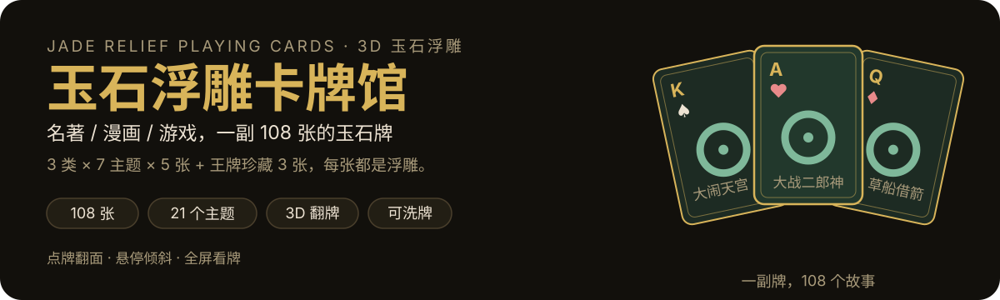
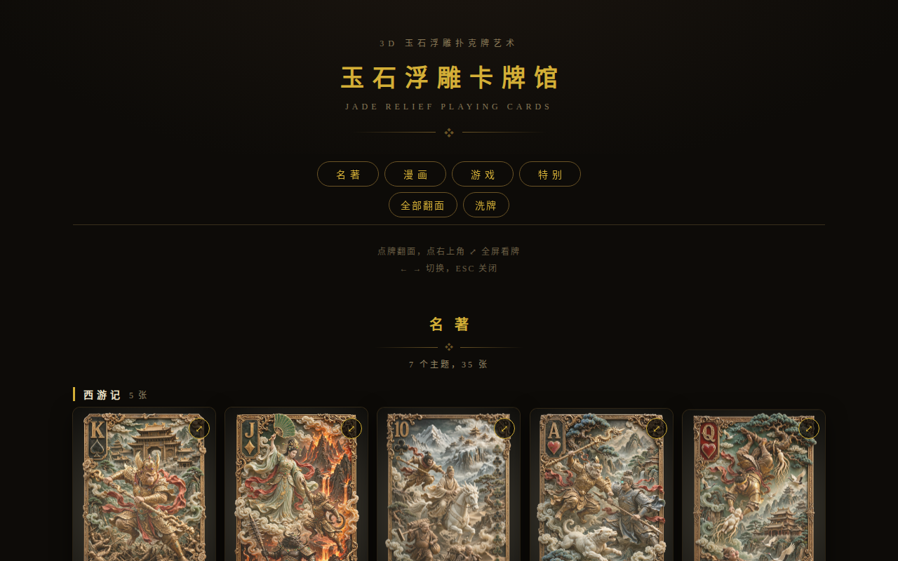
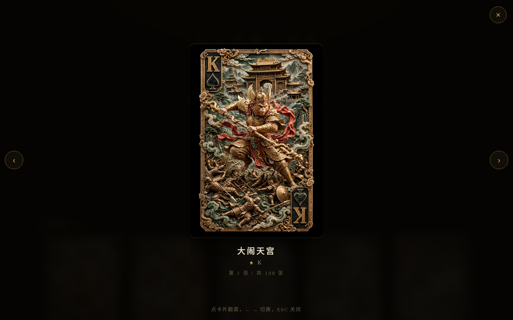

<p align="right"><a href="README.md">中文</a></p>

<p align="center">
  
</p>

<p align="center">
  <a href="https://holynova.github.io/jade-relief-cards/">▶ View Online</a>
  ·
  <a href="https://github.com/holynova/jade-relief-cards">GitHub Repository</a>
</p>

Jade Relief Cards is a gallery of 108 playing cards rendered as jade relief art: 3 categories (classic literature, manga, games) × 7 themes × 5 cards, plus 3 treasure cards. Every card is a jade relief artwork with a real poker rank (K♠ Havoc in Heaven, A♥ Battle with Erlang Shen…). Click to flip in 3D, hover to tilt, view full-screen one by one.

## Screenshots

<p align="center">
  
  <br>
  
</p>

## The Deck

| Category | Themes (5 cards each) |
| --- | --- |
| 名著 (Classics) · 35 | 西游记 (Journey to the West), 三国演义 (Romance of the Three Kingdoms), 水浒传 (Water Margin), 红楼梦 (Dream of the Red Chamber), 聊斋志异 (Strange Tales from a Chinese Studio), 封神演义 (Investiture of the Gods), 史记 (Records of the Grand Historian) |
| 漫画 (Comics) · 35 | 龙珠 (Dragon Ball), 海贼王 (One Piece), 火影忍者 (Naruto), 鬼灭之刃 (Demon Slayer), 哆啦A梦 (Doraemon), 名侦探柯南 (Detective Conan), 灌篮高手 (Slam Dunk) |
| 游戏 (Games) · 35 | 黑神话：悟空 (Black Myth: Wukong), 艾尔登法环 (Elden Ring), 塞尔达传说 (The Legend of Zelda), 原神 (Genshin Impact), 宝可梦 (Pokémon), 王者荣耀 (Honor of Kings), 超级马里奥 (Super Mario) |
| 特别 (Special) · 3 | 王牌珍藏 (Ace Collection): 九龙玉玺 (Nine-Dragon Jade Seal, big joker), 和氏璧 (He's Jade, small joker), 卡牌馆纪念 (Gallery commemorative card) |

Every card has a name and a rank: Havoc in Heaven is K♠, Oath of the Peach Garden is A♠, Pikachu is A♥, Mario is 7♦.

## Features

- **Click to flip**: every card flips with a 3D animation, sharing one jade card back. The 5 Journey to the West cards start face-up, so you see the artwork right away.
- **Hover to tilt**: cards tilt to follow the pointer with a sheen sweep (disabled on touch devices).
- **Flip all / shuffle**: flip all 108 cards face-up or face-down with one click; shuffle randomizes the order within each theme.
- **Full-screen viewer**: click the corner of a card to enlarge it — browse one card at a time in full screen, click to flip, ← → to switch, ESC to close, with a "card N of 108" counter below.
- **Category navigation**: four entrances （名著 Classics / 漫画 Comics / 游戏 Games / 特别 Special) jump straight to each section; images lazy-load (110 WebP files, ~83 MB total, loaded on demand).

## Run Locally

Pure static site — just open `index.html`, or serve it:

```bash
python3 -m http.server 8000
# Open http://localhost:8000
```

## Tech

- Zero build, zero dependencies: a single `index.html` (data, styles, and logic all inside), no external requests.
- 3D flips use CSS `preserve-3d` + `rotateY`; tilting computes `rotateX/Y` from pointer position; images lazy-load.
- `img/` also holds 99 `media-generation-*.json` files — generation metadata for each image.

```
index.html          Entry: data for 108 cards + 3D flip / tilt / full-screen browsing
img/                110 WebP images (108 card faces + 2 card backs) + 99 generation-metadata JSONs
```

## Note

The card artwork is AI-generated in a jade relief style; characters and stories are drawn from classic works and pop culture, and their rights belong to their respective owners.
