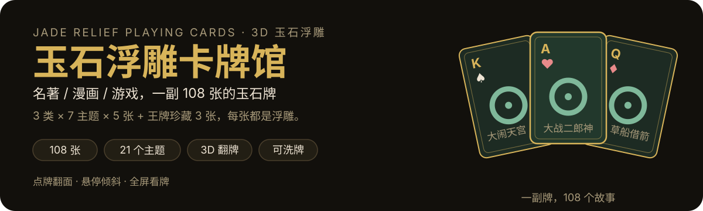
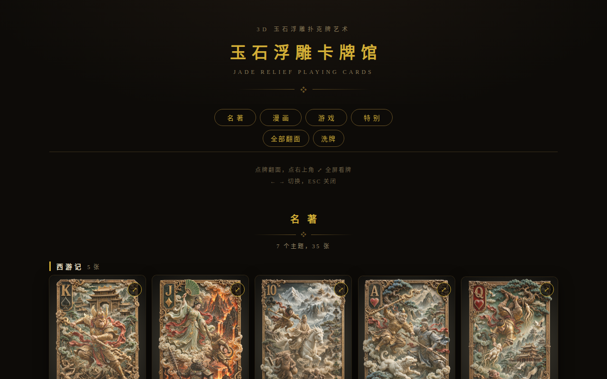
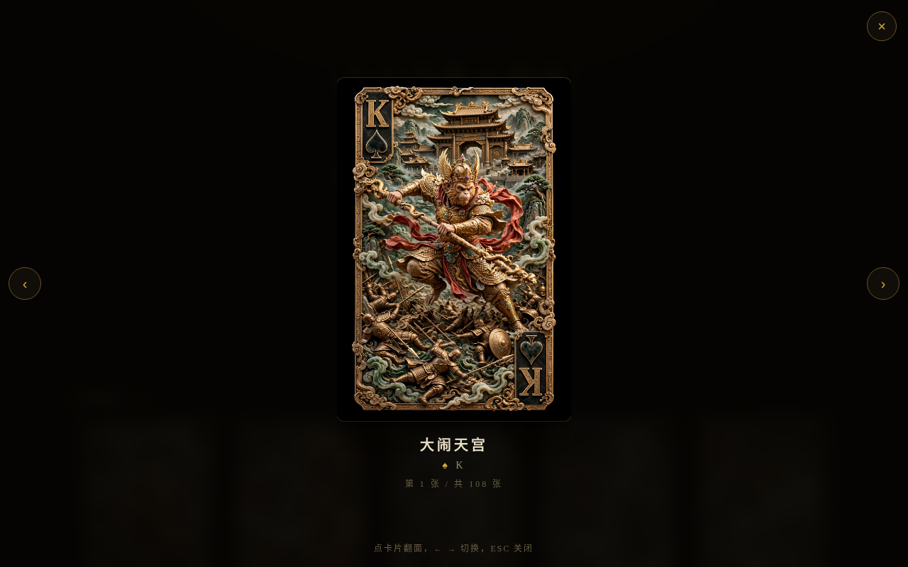

<p align="center">
  
</p>

<p align="center">
  <a href="https://holynova.github.io/jade-relief-cards/">▶ 在线看牌 View Online</a>
  ·
  <a href="https://github.com/holynova/jade-relief-cards">GitHub 仓库</a>
</p>

玉石浮雕卡牌馆是一副 108 张的玉石浮雕扑克牌：名著、漫画、游戏 3 类 × 7 主题 × 5 张，再加王牌珍藏 3 张。每张牌都是一幅玉石浮雕画，并配有真实扑克牌面（黑桃 K 大闹天宫、红桃 A 大战二郎神……）。点牌 3D 翻面，悬停倾斜，全屏一张张看。

A gallery of 108 jade-relief playing cards: 3 categories (classic literature, manga, games) × 7 themes × 5 cards, plus 3 treasure cards. Every card is a jade relief artwork with a real poker rank (K♠ Havoc in Heaven, A♥ Battle with Erlang Shen…). Click to flip in 3D, hover to tilt, view full-screen one by one.

## 截图 / Screenshots

<p align="center">
  
  <br>
  
</p>

## 牌面清单 / The Deck

| 类别 | 主题（各 5 张） |
| --- | --- |
| 名著 · 35 张 | 西游记、三国演义、水浒传、红楼梦、聊斋志异、封神演义、史记 |
| 漫画 · 35 张 | 龙珠、海贼王、火影忍者、鬼灭之刃、哆啦A梦、名侦探柯南、灌篮高手 |
| 游戏 · 35 张 | 黑神话：悟空、艾尔登法环、塞尔达传说、原神、宝可梦、王者荣耀、超级马里奥 |
| 特别 · 3 张 | 王牌珍藏：九龙玉玺（大王）、和氏璧（小王）、卡牌馆纪念（纪念牌） |

每张牌都有名字与牌面：大闹天宫是黑桃 K、桃园三结义是黑桃 A、皮卡丘是红桃 A、马里奥是方块 7。

## 功能 / Features

- **点牌翻面**：每张牌都是 3D 翻牌动画，牌背是统一的玉石卡背；首屏先翻开西游记 5 张，一进来就看到画。
- **悬停倾斜**：鼠标划过卡片跟随倾斜，带流光扫过效果（触屏设备不启用）。
- **全部翻面 / 洗牌**：一键翻开或翻回全部 108 张；洗牌打乱每个主题内的牌序。
- **全屏看牌**：点卡片右上角放大，全屏单张浏览，点牌翻面，← → 切换，ESC 关闭，下方显示"第 N 张 / 共 108 张"。
- **分类导航**：名著 / 漫画 / 游戏 / 特别四个入口直达；图片懒加载，110 张 WebP 约 83 MB，按需加载。

## 本地运行 / Run Locally

纯静态站，直接打开 `index.html` 即可；或起一个静态服务器：

```bash
python3 -m http.server 8000
# 打开 http://localhost:8000
```

## 技术 / Tech

- 零构建、零依赖：单个 `index.html`（数据、样式、逻辑都在里面），无外部请求。
- 3D 翻牌用 CSS `preserve-3d` + `rotateY`；倾斜用指针位置算 `rotateX/Y`；图片懒加载。
- `img/` 下另有 99 个 `media-generation-*.json`，是每张图的生成元数据。

```
index.html          入口：108 张牌的数据 + 3D 翻牌 / 倾斜 / 全屏浏览
img/                110 张 WebP（108 张牌面 + 2 张卡背）+ 99 个生成元数据 JSON
```

## English

**Jade Relief Cards** is a gallery of 108 playing cards rendered as jade relief art — 3 categories × 7 themes × 5 cards, plus 3 treasure cards.

- **Classics (35)**: Journey to the West, Romance of the Three Kingdoms, Water Margin, Dream of the Red Chamber, Strange Tales (Liaozhai), Investiture of the Gods, Records of the Grand Historian.
- **Manga (35)**: Dragon Ball, One Piece, Naruto, Demon Slayer, Doraemon, Detective Conan, Slam Dunk.
- **Games (35)**: Black Myth: Wukong, Elden Ring, The Legend of Zelda, Genshin Impact, Pokémon, Honor of Kings, Super Mario.
- **Treasure (3)**: Nine-Dragon Jade Seal (big joker), He's Jade (small joker), Gallery commemorative card.
- **Every card has a real poker rank**: Havoc in Heaven is K♠, Oath of the Peach Garden is A♠, Pikachu is A♥, Mario is 7♦.
- **Features**: click any card to flip it in 3D (shared jade card back); hover to tilt with a sheen sweep; flip-all and per-theme shuffle buttons; full-screen viewer with flip, ← → navigation, ESC to close and a "N / 108" counter; lazy-loaded images (110 WebP files, ~83 MB total).
- **Run it**: open `index.html` — no build step, no dependencies, no external requests.
